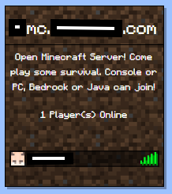

This is a compilation of files to use to display basic server and player information to a website. 

Working on Minecraft versions 26.X

Included are the base html, css, and javascript.

Go through playerList.js and index.html and replace "mc.example.com" with either your domain name or ip being used by people to join your server. Also change "25565" to the port you are using.

Remember to set "enable-query=true" in your Minecraft "server.properties" file to allow the api to gather the information it needs for the display.

Here is an example of what the display will look like when set up properly.

